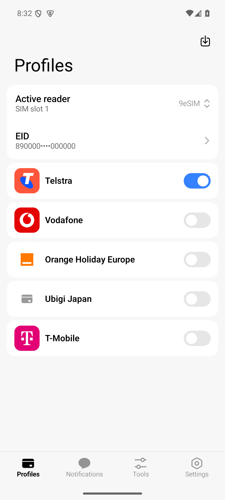
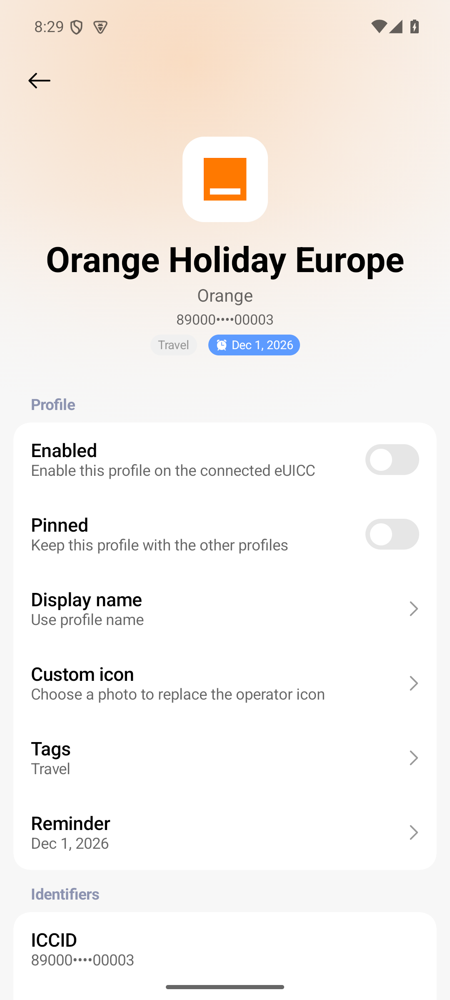
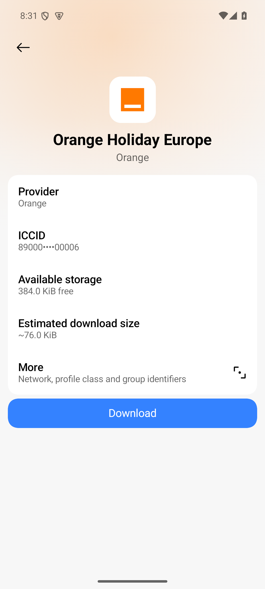
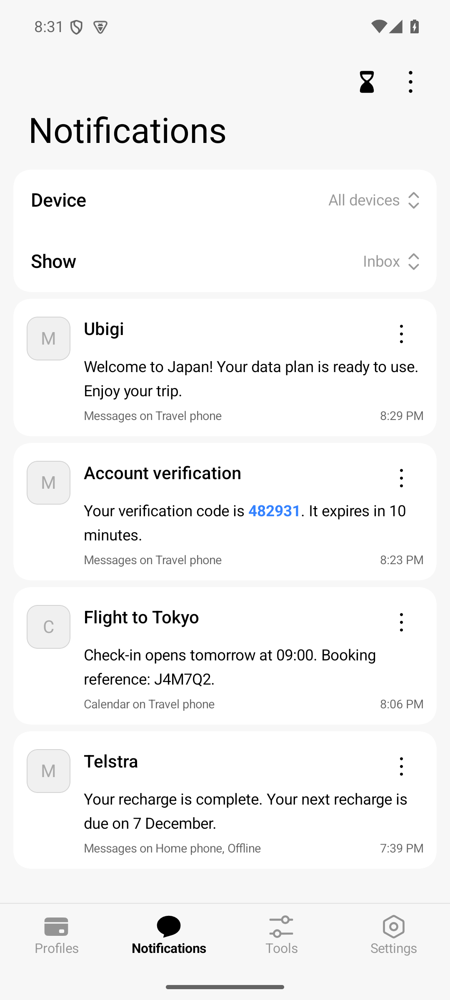
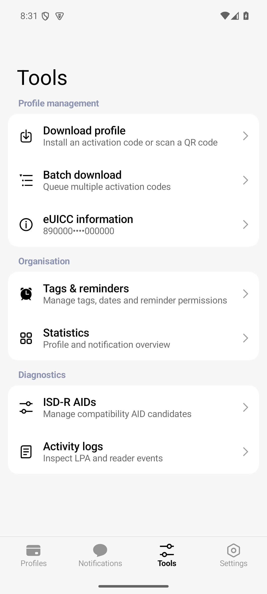
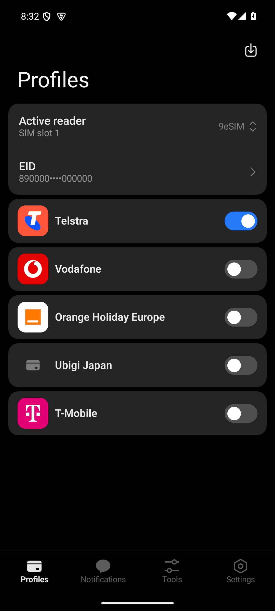

<p align="center">
  
</p>

<h1 align="center">HyperLPA</h1>

<p align="center">
  A native Android Local Profile Assistant for managing eSIM profiles through compatible eUICC readers.
</p>

<p align="center">
  <a href="https://github.com/FreeTeaspoon/HyperLPA/actions/workflows/android.yml"></a>
  <a href="LICENSE"></a>
  <a href="https://github.com/FreeTeaspoon/HyperLPA/releases"></a>
</p>

Manage eSIM profiles, download new plans, and switch between them in a Miuix interface.
Connect through a compatible phone, USB or Bluetooth reader, or a paired Android device.

## Screenshots

<table>
  <tr>
    <td align="center"><br>Profiles</td>
    <td align="center"><br>Profile details</td>
    <td align="center"><br>Download a profile</td>
  </tr>
  <tr>
    <td align="center"><br>Notifications</td>
    <td align="center"><br>Tools</td>
    <td align="center"><br>Dark mode</td>
  </tr>
</table>

Screenshots use fictional profiles, identifiers, and messages. Carrier names are
illustrative and do not imply affiliation.

## Get started

Requires Android 13 or newer, a compatible eUICC, and a supported reader.

1. Download **`app-arm64-v8a-release.apk`** from [GitHub Releases](https://github.com/FreeTeaspoon/HyperLPA/releases) for most modern phones and tablets.
2. Open **Settings → eUICC readers**, enable your reader backend, and discover readers.
3. Select your reader, then download a profile using your operator's activation code or QR code.

> [!IMPORTANT]
> A phone having an eSIM does not guarantee access. Hardware, firmware, Android
> privileges, and the card's APK signing allowlist determine which readers work.
> The ordinary release uses the public [9eSIM Community Key](https://github.com/9esim/9eSIMCommunityKey).
> Sideloading a privileged APK does not grant system permissions.

Reader backends include Android OMAPI, NBridge / OTBridge, USB CCID,
Bluetooth LE, RemoCard v2, and privileged telephony. For Bluetooth, pair your reader
in Android settings first and grant Nearby devices permission.

Other release APKs support older ARM devices and x86 emulators. Use the ABI that
matches your device and check the download against the release's `SHA256SUMS`.

## Features

- Enable, disable, rename, delete, and organise profiles with tags, reminders, and provider artwork.
- Download from activation codes, QR codes, or `lpa:` links, with batch queues and foreground progress.
- Inspect eUICC storage and profile details, process pending notifications, and view operation history.
- Manage readers on paired Android devices and view shared phone notifications through an encrypted relay.
- Back up settings and profile metadata with password encryption. Installed eSIM profiles stay on the card.
- Export redacted support reports and choose light, dark, or system themes with configurable colours and navigation.

## Remote access

Pair Android devices through the [encrypted relay](relay/README.md) to manage
their readers and view shared phone notifications. A [web dashboard](web/README.md)
is also available. Notification sharing requires Android notification access and
explicit permission for each paired viewer.

## Privacy

HyperLPA stores settings and profile metadata locally. Optional artwork and size
references use third-party services; icon requests can reveal your IP address
and operator. HyperLPA does not upload installation reports.

## Build from source

Requires Java 21, Android SDK 37, and NDK `29.0.14206865`.

```shell
git clone --recurse-submodules https://github.com/FreeTeaspoon/HyperLPA.git
cd HyperLPA
./gradlew :app:assembleDebug
```

Debug APKs are written to `app/build/outputs/apk/debug/`.

## Credits

[OpenEUICC](https://github.com/estkme-group/openeuicc) and
[lpac](https://github.com/estkme-group/lpac) provide the LPA engine.
[NekokoLPA2](https://github.com/iebb/NekokoLPA2) informed reader support,
operator-icon lookup, and profile-size predictions, including the optional
profile-size reference database. Carrier artwork comes from
[operator-icons](https://operator-icons.pages.dev/).
The interface uses [Miuix](https://github.com/compose-miuix-ui/miuix), with About
screen and UI references from [Mishka](https://github.com/YuKongA/Mishka).

## Contributing

Report bugs or suggest changes in the [issue tracker](https://github.com/FreeTeaspoon/HyperLPA/issues).
Include your reader backend, Android version, device model, and a redacted support
report when useful. Never post activation codes, eUICC identifiers, or credentials.

HyperLPA uses Kotlin, Jetpack Compose, Miuix, and `lpac-jni`.
Licensed under [GPL-3.0](LICENSE). See [NOTICE](NOTICE) for third-party attribution
and the [reference audit](docs/reference-audit.md) for source and licensing decisions.
