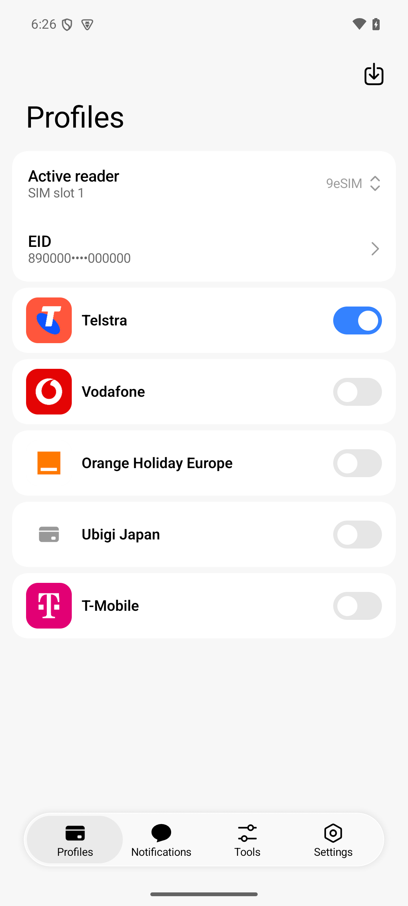
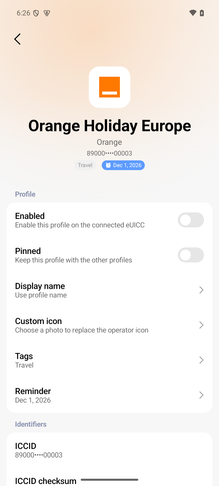
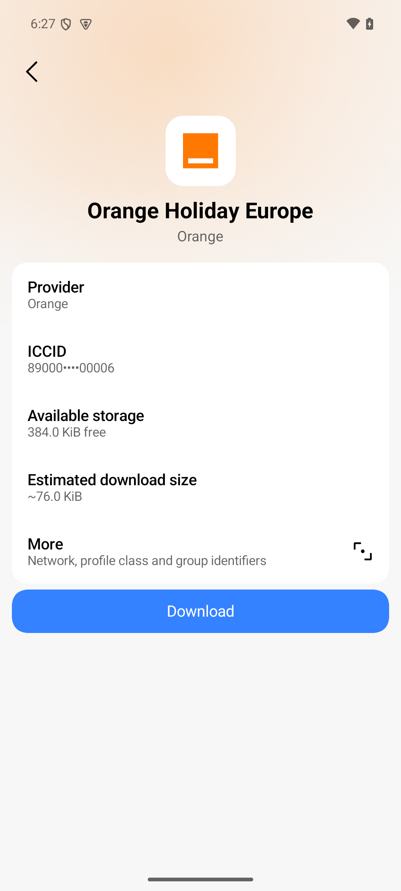
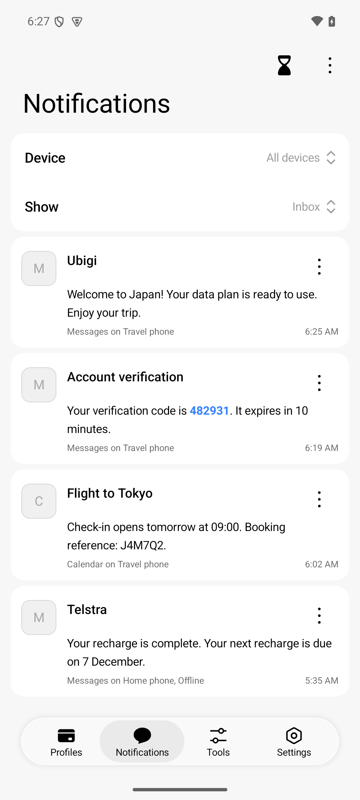
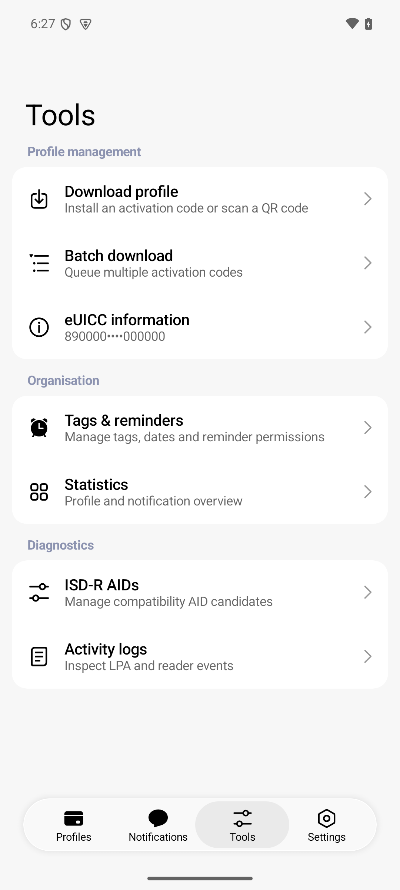
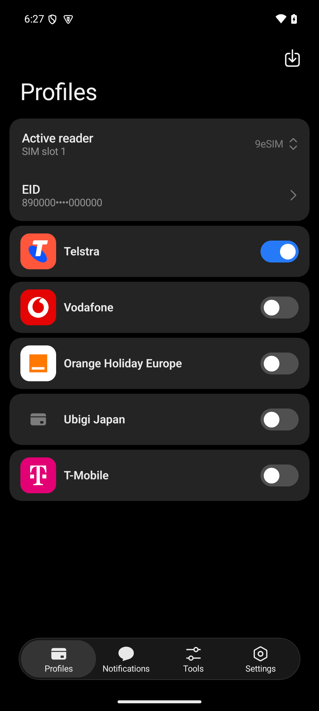

<p align="center">
  
</p>

<h1 align="center">HyperLPA</h1>

[English](../README.md) · **简体中文**

<p align="center">
  HyperLPA 是一款原生 Android 本地配置文件助手（LPA），可通过兼容的 eUICC 读卡器管理 eSIM 配置文件。
</p>

<p align="center">
  <a href="https://github.com/FreeTeaspoon/HyperLPA/actions/workflows/android.yml"></a>
  <a href="../LICENSE"></a>
  <a href="https://github.com/FreeTeaspoon/HyperLPA/releases"></a>
</p>

在 Miuix 界面中管理 eSIM 配置文件、下载新套餐，并在不同套餐之间切换。
你可以通过兼容的手机、USB 或蓝牙读卡器，或已配对的 Android 设备连接 eUICC。

---

## 应用截图

<div align="center">

<table>
  <thead>
    <tr>
      <th width="33%" align="center">配置文件</th>
      <th width="33%" align="center">详情</th>
      <th width="33%" align="center">添加 eSIM</th>
    </tr>
  </thead>
  <tbody>
    <tr>
      <td align="center"><a href="../screenshots/profiles.png"></a></td>
      <td align="center"><a href="../screenshots/profile-details.png"></a></td>
      <td align="center"><a href="../screenshots/download.png"></a></td>
    </tr>
  </tbody>
</table>

<table>
  <thead>
    <tr>
      <th width="33%" align="center">提醒</th>
      <th width="33%" align="center">工具</th>
      <th width="33%" align="center">深色模式</th>
    </tr>
  </thead>
  <tbody>
    <tr>
      <td align="center"><a href="../screenshots/notifications.png"></a></td>
      <td align="center"><a href="../screenshots/tools.png"></a></td>
      <td align="center"><a href="../screenshots/profiles-dark.png"></a></td>
    </tr>
  </tbody>
</table>

</div>

截图展示了 Miuix OS4 Glass 界面和 Miuix 悬浮底栏。截图中的配置文件、标识符和消息均为虚构。运营商名称仅用于演示，不代表存在合作关系。

---

## 开始使用

需要 Android 13 或更高版本、兼容的 eUICC 和受支持的读卡器。

1. 大多数新款手机和平板电脑可从 [GitHub 发布页面](https://github.com/FreeTeaspoon/HyperLPA/releases)下载 **`app-arm64-v8a-release.apk`**。
2. 在 HyperLPA 中打开 **设置 → eUICC 读卡器**，启用对应的读卡方式，然后搜索读卡器。
3. 选择读卡器，使用运营商提供的激活码或二维码下载配置文件。

> [!IMPORTANT]
> 手机支持 eSIM 并不代表 HyperLPA 可以访问它。读卡器能否使用取决于硬件、固件、Android 权限以及卡片的 APK 签名白名单。
> 普通版本使用公开的 [9eSIM 社区密钥](https://github.com/9esim/9eSIMCommunityKey)。手动安装特权 APK 不会授予系统权限。

支持的读卡方式包括 Android OMAPI、NBridge / OTBridge、USB CCID、低功耗蓝牙（BLE）、RemoCard v2 和需要特权的电话服务接口。使用蓝牙读卡器时，请先在 Android 设置中配对，再授予“附近的设备”权限。

发布页面还提供适用于旧款 ARM 设备和 x86 模拟器的 APK。请选择与设备 ABI 匹配的版本，并使用该版本的 `SHA256SUMS` 文件校验下载的 APK。

在 HyperLPA 中打开**设置 → 语言**，选择应用语言或跟随 Android 系统语言。网页控制台可在**语言**菜单中选择语言，也可以跟随浏览器语言。
两者均支持英语、西班牙语、简体中文、繁体中文、法语、德语、日语、韩语和巴西葡萄牙语。尚无翻译的内容会显示为英语。

## 功能

- 启用、停用、重命名或删除配置文件，并用标签、提醒和运营商图标进行管理。
- 通过激活码、二维码或 `lpa:` 链接下载配置文件，支持批量排队和前台进度显示。
- 查看 eUICC 存储和配置文件详情、处理队列中的通知，并查看操作记录。
- 通过加密中继管理已配对 Android 设备上的读卡器，并查看共享的手机通知。
- 使用密码加密备份设置和配置文件元数据。已安装的 eSIM 配置文件仍保留在卡片上。
- 导出已隐去敏感信息的支持报告，选择浅色、深色或跟随系统的主题，并自定义配色和导航方式。

## 远程访问

通过[加密中继](../relay/README.md)配对 Android 设备后，可以管理这些设备上的读卡器并查看共享的手机通知。也可以使用[网页控制台](../web/README.md)。共享通知需要 Android 的通知访问权限，并且要单独授权每个查看方。

## 隐私

HyperLPA 将设置和配置文件元数据保存在本机。可选的运营商图标和配置文件大小参考数据来自第三方服务。请求图标时，第三方服务可能获知你的 IP 地址和运营商。HyperLPA 不会上传安装报告。

## 从源码构建

需要 Java 21、Android SDK 37 和 NDK `29.0.14206865`。

```shell
git clone --recurse-submodules https://github.com/FreeTeaspoon/HyperLPA.git
cd HyperLPA
./gradlew :app:assembleDebug
```

构建生成的调试版 APK 位于 `app/build/outputs/apk/debug/`。

## 致谢

[OpenEUICC](https://github.com/estkme-group/openeuicc) 和 [lpac](https://github.com/estkme-group/lpac) 提供 LPA 引擎。
读卡器支持、运营商图标查询和配置文件大小预测参考了 [NekokoLPA2](https://github.com/iebb/NekokoLPA2)，可选的配置文件大小参考数据库也来自该项目。运营商图标来自 [operator-icons](https://operator-icons.pages.dev/)。
界面使用 [Miuix](https://github.com/compose-miuix-ui/miuix)。“关于”页面及其他界面设计参考了 [Mishka](https://github.com/YuKongA/Mishka)。

## 参与贡献

请在 [GitHub 问题跟踪器](https://github.com/FreeTeaspoon/HyperLPA/issues)报告问题或提出建议。请注明读卡方式、Android 版本和设备型号，并在有帮助时附上已隐去敏感信息的支持报告。切勿公开激活码、eUICC 标识符或凭据。

准备发布新版本时，请在 [`.github/release-notes/`](../.github/release-notes/) 中添加以 Git 标签命名的 Markdown 文件。列出用户能感知的变更，包括新增功能和修复。GitHub 会将该文件发布为版本说明。

HyperLPA 使用 Kotlin、Jetpack Compose、Miuix 和 `lpac-jni`。
本项目采用 [GPL-3.0](../LICENSE) 许可证。第三方署名见 [NOTICE](../NOTICE)，源码来源与许可方面的决定见[参考审计](../docs/reference-audit.md)。
